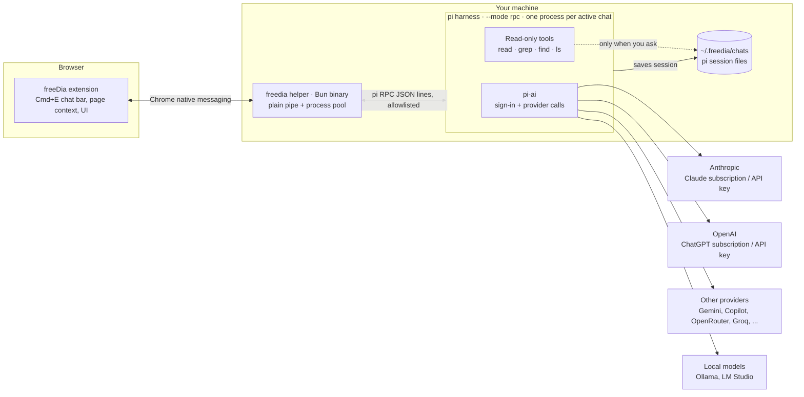

# Initial Architecture: Extension + Local Helper + pi

> freeDia doesn't reinvent agent tooling. The extension is only the interface. A small local helper runs **pi** as the harness, and pi uses **pi-ai** to sign in to and call every provider.



## Pieces

- **Extension:** UI only. Cmd+E, highlighted text + URL + page text (built into the message), chat bar, model picker, history list, drag/resize/expand. Stores no conversation data.
- **Helper (`freedia`):** installer plus a small background process that Chrome starts when needed. A plain pipe: routes `{ chatId, rpc }` messages to that chat's pi process, forwards allowlisted pi commands, runs the process pool, and lists/deletes chats.
- **pi (harness):** runs the loop where the model asks for a tool, pi runs it and sends back the result. Supplies the built-in tools.
- **pi-ai (inside pi):** sign-in (`/login` for subscriptions or API keys), the list of providers, requests and streaming. About 35 providers out of the box.

## Decisions

- **Harness:** pi, controlled over RPC (`--mode rpc`). We write no tools of our own in v1.
- **Sign-in and providers:** pi-ai handles all of it. A new provider is a pi login or config entry; no freeDia code changes.
- **Extension ↔ helper:** Chrome native messaging, not an open localhost port, which any website could try to send commands to.
- **Models:** the picker lists whatever pi has signed-in access to (Claude Sonnet/Opus/Haiku, GPT/Codex, Gemini, local models, ...). Switching models mid-chat uses pi-ai's built-in handoff.
- **Agent permissions (v1):** read-only. pi is started (one process per active chat) with
  ```sh
  pi --mode rpc --session-dir ~/.freedia/chats --session-id <chatId> \
     --model <selected> --tools read,grep,find,ls \
     --no-extensions --no-skills --no-prompt-templates --no-context-files \
     --append-system-prompt "<freeDia rules>"
  ```
  `bash`, `edit`, `write`, `codemode`, `tool_search` and MCP tools are off for the model; the helper also blocks pi's RPC `bash` command. Page URL, highlight and page text go into the message text, so pi keeps them in the session.
- **Previous chats:** the agent reads `~/.freedia/chats` only when you explicitly ask about earlier chats. Enforced through the instructions it's given for now; a hard block can come later.
- **Extension stack:** WXT + React + Tailwind. The chat UI loads on first Cmd+E inside an isolated shadow DOM. React's ~68 KB gzipped baseline is acceptable; Preact is a drop-in fallback if the first open ever feels slow.
- **Helper runtime:** Bun, compiled to a single binary with `bun build --compile`. pi runs under Bun ≥ 1.4 (verified: pi 1.3.0 starts and answers RPC on Bun 1.4.3; crashes on Bun 1.2.16). Node ≥ 22.19 only as a fallback for pi if a Bun incompatibility shows up.
- **Shortcuts:** Chrome default Cmd+Shift+E (Ctrl+Shift+E on Windows/Linux) through Chrome's built-in shortcut setting; Dia default Cmd+E through the page script, chosen by detecting Dia or a first-run "Using Dia?" prompt. Both changeable in settings.
- **New chat:** "+" button in the chat bar header.
- **Re-highlight:** pressing the shortcut with new text highlighted while a chat is open adds it to the current chat as another quote.
- **Window modes (v1):** floating chat window as a page overlay (drag, resize, expand), matching Dia's floating chat. Stretch: "float above other apps" through Document Picture-in-Picture, if an early test shows it works. Open-in-new-tab, pop-out window and side panel are not in v1.
- **Tab scope:** each overlay chat belongs to its tab.
- **Helper is a plain pipe:** the extension sends pi RPC commands wrapped in `{ chatId, rpc }`; the helper forwards an allowlist (`prompt`, `abort`, `set_model`, `get_available_models`, `get_messages`, `get_state`) and blocks the rest, including pi's RPC `bash`. Its only own commands: `helper.hello`, `chat.list`, `chat.delete`, plus `chat.status` pushes.
- **History:** chats are pi sessions (`--session-dir ~/.freedia/chats --session-id <chatId>`). No freeDia chat format, no IndexedDB cache.
- **Multiple chats:** one pi process per generating chat; max 3 at once (others queue). Each process exits when its reply finishes; the next message respawns pi (~180 ms measured) and resumes from the session file. No warm pool. ~91 MB per pi process (measured idle).
- **Install:** Chrome Web Store, then `bunx freedia install` once. The installer places the helper binary and installs pi (`@earendil-works/pi-coding-agent`). The extension detects a missing helper and shows the command.
- **No freeDia servers:** everything runs on the user's machine against their own subscriptions or keys.

## Open questions / to test first

- Confirm the read-only allowlist behaves as documented (`--no-extensions` also turns off pi's built-in MCP).
- pi RPC protocol details: streaming events, switching models mid-session, aborting.
- Startup delay: one long-running pi process per chat vs. starting pi per message.
- Sign-in flow: run pi's `/login` from the installer, or start it from the extension.
- Future write tools need a confirmation step in freeDia (pi doesn't ask before tool calls).
